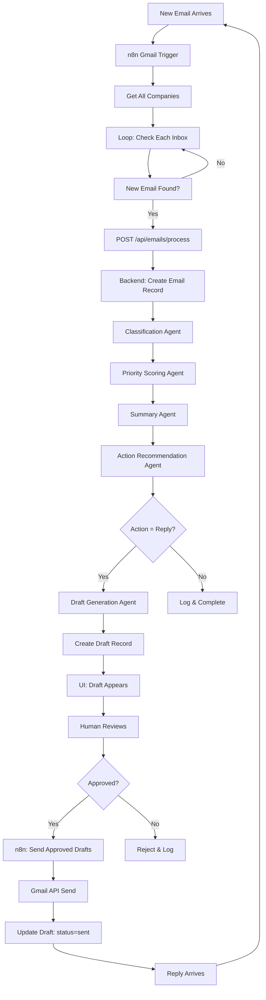

# Flow 1: Inbound Email → Response - Implementation Plan

## Overview

This plan implements Flow 1 from the Blueprint, creating a complete pipeline from email arrival to human-approved response. The implementation follows the Architecture document's separation: n8n handles orchestration, backend handles business logic and AI agents.

## Current State

**Completed:**

- Company registration and OAuth connection
- Database schema (6 tables with all required fields)
- Basic backend API structure (`/api/emails/process` exists with placeholder logic)
- Frontend UI structure (Drafts page, Priority Queue page exist)
- Policy loader service (can load from Drive)

**Needs Implementation:**

- n8n workflow for email ingestion (watching all company inboxes)
- Classification agents (rule-based initially)
- Priority scoring algorithm
- Summary generation
- Draft generation with templates
- Enhanced UI for draft review
- n8n workflow for sending approved drafts

---

## Phase 1: Email Ingestion (n8n + Backend)

**Goal:** Detect new emails in all company Gmail inboxes and store them in database.

### n8n Workflow: "Email Ingestion"

**Workflow Structure:**

1. **Schedule Trigger** - Runs every 5 minutes
2. **HTTP Request Node** - Get all companies with OAuth: `GET /api/companies/`
3. **Split In Batches Node** - Process companies one by one
4. **Gmail Node** - Check inbox for new emails (using company's credential)
5. **Filter Node** - Only process emails not seen before (check `gmail_message_id`)
6. **HTTP Request Node** - For each new email, call: `POST /api/emails/process`
7. **Error Handling** - Log failures, continue with next company

**Key Implementation Details:**

- Use `n8n_credential_id` from company record to authenticate Gmail API
- Track last processed timestamp per company (optional, for efficiency)
- Handle errors gracefully (one company failure shouldn't stop others)
- Pass `credential_id` in request to backend for company mapping

### Backend Enhancement: Email Processing Endpoint

**File:** `backend/routers/emails.py` - `process_email()` function

**Current State:** Endpoint exists but has placeholder classification

**Enhancements Needed:**

1. **Duplicate Prevention:**

   - Check if `gmail_m`
   - `essage_id` already exists in database
   - Return early if duplicate found (idempotency)

2. **Thread Context:**

   - Extract `thread_id` from Gmail message
   - Link to existing email if thread_id matches

3. **Email Storage:**

   - Store raw email data (subject, body, from, to)
   - Store `gmail_message_id` for duplicate prevention
   - Store `thread_id` for conversation grouping
   - Set initial status

4. **Error Handling:**

   - Validate required fields
   - Handle missing company mapping gracefully
   - Return clear error messages to n8n

### Database

**No schema changes needed** - Email table already has all required fields:

- `gmail_message_id` (unique constraint exists)
- `thread_id` (indexed)
- All classification fields (nullable, will be filled in Phase 2)

### Testing

- Test with single company first
- Test with multiple companies
- Test duplicate email handling
- Test error scenarios (invalid credential, missing company)

---

## Phase 2: Classification Agents (Rule-Based)

**Goal:** Classify emails using simple rule-based logic (before AI implementation).

### Backend Service: Classification Agent

**New File:** `backend/services/classification.py`

**Agent Logic:**

1. **Function Classification:**

   - Keyword matching: "pricing", "price", "cost" → "Sales"
   - "resume", "job", "position", "hire" → "Hiring"
   - "support", "help", "issue" → "Support"
   - "legal", "contract", "agreement" → "Legal"
   - Default → "Admin"

2. **Intent Classification:**

   - "interested", "inquiry", "question" → "Inquiry"
   - "follow up", "following up" → "Follow-up"
   - "objection", "concern", "worried" → "Objection"
   - "schedule", "meeting", "call" → "Scheduling"
   - Default → "Inquiry"

3. **Urgency Classification:**

   - "urgent", "asap", "immediately" → "Immediate"
   - "soon", "quickly" → "Soon"
   - Default → "Can wait"

4. **Impact Classification:**

   - Sales inquiry → "Revenue"
   - Hiring inquiry → "Hiring"
   - Support issue → "Brand"
   - Default → "Low"

5. **Confidence Classification:**

   - Clear keywords found → "Clear"
   - Ambiguous keywords → "Ambiguous"
   - No keywords → "Missing info"

### Backend Integration

**File:** `backend/routers/emails.py` - Update `process_email()` function

**Changes:**

1. After creating email record, call classification service
2. Update email record with classification results
3. Store full classification in `classification_metadata` JSON field

### Database

**No schema changes** - All classification fields exist in Email table:

- `function`, `intent`, `urgency`, `impact`, `confidence`
- `classification_metadata` (JSON field)

### Testing

- Test with various email types (sales, hiring, support)
- Verify classification accuracy
- Test edge cases (empty emails, very long emails)

---

## Phase 3: Priority Scoring Agent

**Goal:** Calculate priority score (0-100) based on classification signals.

### Backend Service: Priority Scoring Agent

**New File:** `backend/services/priority_scorer.py`

**Scoring Algorithm:**

1. **Base Score:** 50 (neutral starting point)

2. **Function Multipliers:**

   - Sales → +20
   - Hiring → +15
   - Legal → +10
   - Support → +5
   - Admin → 0

3. **Impact Multipliers:**

   - Revenue → +15
   - Hiring → +10
   - Brand → +5
   - Low → 0

4. **Urgency Multipliers:**

   - Immediate → +10
   - Soon → +5
   - Can wait → 0

5. **Intent Multipliers:**

   - Inquiry → +5
   - Follow-up → +3
   - Objection → +8 (needs attention)
   - Scheduling → +2

6. **Confidence Penalty:**

   - Clear → 0 (no penalty)
   - Ambiguous → -5
   - Missing info → -10

7. **Final Score:** Clamp between 0-100

**Company Context (Future Enhancement):**

- Apply company-specific multipliers based on stage/importance
- For now, use standard scoring

### Backend Integration

**File:** `backend/routers/emails.py` - Update `process_email()` function

**Changes:**

1. After classification, call priority scorer
2. Update email record with `priority_score`
3. Score stored as string (for database compatibility)

### Database

**No schema changes** - `priority_score` field exists (String type, indexed)

### Testing

- Test scoring with various classification combinations
- Verify scores are in 0-100 range
- Test edge cases (all high signals, all low signals)

---

## Phase 4: Executive Summary Agent

**Goal:** Generate 1-2 line executive summary for quick understanding.

### Backend Service: Summary Agent

**New File:** `backend/services/summarizer.py`

**Template-Based Approach (Initial):**

1. **Template Selection:**

   - Based on function + intent combination
   - Example templates:
     - Sales + Inquiry → "Customer inquiry about {topic} - needs {action}"
     - Hiring + Application → "Job application received for {role}"
     - Support + Complaint → "Support issue reported - {issue_type}"

2. **Variable Extraction:**

   - Extract topic from email subject/body
   - Extract action needed from intent
   - Extract role/issue type from keywords

3. **Summary Generation:**

   - Fill template with extracted variables
   - Ensure 1-2 lines maximum
   - No quoting, no fluff (per Blueprint requirement)

**Future Enhancement:** Replace with LLM-based summarization

### Backend Integration

**File:** `backend/routers/emails.py` - Update `process_email()` function

**Changes:**

1. After priority scoring, call summarizer
2. Update email record with `executive_summary`

### Database

**No schema changes** - `executive_summary` field exists (Text type)

### Testing

- Test with various email types
- Verify summaries are concise (1-2 lines)
- Test template matching logic

---

## Phase 5: Action Recommendation & Draft Generation

**Goal:** Recommend action and generate draft reply for human review.

### Backend Service: Action Recommendation Agent

**New File:** `backend/services/action_recommender.py`

**Rule-Based Logic:**

1. **Action Selection:**

   - Sales inquiry → "Reply with template"
   - Hiring application → "Review resume"
   - Support issue → "Reply with template" or "Escalate to human"
   - Scheduling request → "Schedule meeting"
   - Objection → "Reply with template" (needs careful response)
   - Default → "Reply with template"

2. **Escalation Rules:**

   - Confidence = "Missing info" → "Ask for missing information"
   - Urgency = "Immediate" + Impact = "Revenue" → "Escalate to human"
   - Objection + Low confidence → "Escalate to human"

### Backend Service: Draft Generation Agent

**New File:** `backend/services/draft_generator.py`

**Template Engine:**

1. **Template Loading:**

   - Use `policy_loader_service.get_templates()` to load company templates
   - Select template based on function + intent
   - Fallback to default template if company template not found

2. **Variable Substitution:**

   - Extract variables from email (customer name, topic, etc.)
   - Fill template variables
   - Apply brand tone (from `policy_loader_service.get_brand_tone()`)

3. **Draft Creation:**

   - Generate subject: "Re: {original_subject}"
   - Generate body from template
   - Apply brand tone adjustments (formal/casual, length, style)

4. **Template Selection Logic:**

   - Sales inquiry → "pricing_inquiry_template.txt"
   - Support issue → "support_response_template.txt"
   - Hiring application → "application_acknowledgment_template.txt"
   - Default → "general_response_template.txt"

### Backend Integration

**File:** `backend/routers/emails.py` - Update `process_email()` function

**Changes:**

1. After summary, call action recommender
2. Update email record with `recommended_action`
3. If action = "Reply with template", call draft generator
4. Create Draft record with:

   - `company_id`, `email_id` (links to original email)
   - `subject`, `body` (generated)
   - `status = "pending"`
   - `template_used` (track which template was used)
   - `variables_used` (JSON string of variables)

### Policy Loader Enhancement

**File:** `backend/services/policy_loader.py`

**Enhancements:**

1. **Template Loading:**

   - Load templates from Drive folder: `/{CompanyName}/templates/`
   - Cache templates in memory
   - Support multiple template formats (.txt, .md)

2. **Brand Tone Loading:**

   - Load from: `/{CompanyName}/policies/brand_tone.txt`
   - Apply tone rules (formal/casual, length preferences)

3. **Error Handling:**

   - If Drive access fails, use default templates
   - Log errors but don't fail email processing

### Database

**No schema changes** - Draft table has all required fields:

- `template_used`, `variables_used` (for tracking)
- `original_body` (for edit tracking)

### Testing

- Test template loading from Drive
- Test template variable substitution
- Test draft creation for various email types
- Test fallback to default templates

---

## Phase 6: UI Review Queue (Frontend Enhancement)

**Goal:** Enable human review, editing, and approval of drafts.

### Frontend: Drafts Page Enhancement

**File:** `frontend/src/pages/Drafts.tsx`

**Current State:** Basic UI exists with draft list and editor

**Enhancements Needed:**

1. **Draft List Improvements:**

   - Show priority score from linked email
   - Show executive summary from linked email
   - Show company name
   - Show original email context (link to email detail)
   - Filter by company, status, date

2. **Draft Detail View:**

   - Show original email (subject, body, from, to)
   - Show classification (function, intent, urgency, impact)
   - Show executive summary
   - Show draft (editable)
   - Show template used (for reference)

3. **Edit Functionality:**

   - Allow editing draft subject and body
   - Track if draft was edited (`is_edited` flag)
   - Save original body before edits

4. **Approval Workflow:**

   - Approve button → calls `POST /api/drafts/{id}/approve`
   - Reject button → calls `POST /api/drafts/{id}/reject`
   - Show approval status after action

### Frontend: Email Detail Component

**New File:** `frontend/src/components/EmailDetail.tsx`

**Purpose:** Show full email context when reviewing draft

**Features:**

- Display original email (subject, body, from, to, date)
- Display classification metadata (function, intent, urgency, impact, confidence)
- Display priority score
- Display executive summary
- Display thread context (if part of conversation)

### Frontend: Priority Queue Enhancement

**File:** `frontend/src/pages/PriorityQueue.tsx`

**Current State:** Shows emails sorted by priority

**Enhancements:**

1. **Link to Drafts:**

   - If email has draft, show link to draft
   - Show draft status badge
   - Click to navigate to draft detail

2. **Email Detail View:**

   - Click email to see full details
   - Show classification breakdown
   - Show recommended action

### Backend: Draft Approval Endpoint

**File:** `backend/routers/drafts.py` - `approve_draft()` function

**Current State:** Endpoint exists

**Enhancements:**

1. **Edit Tracking:**

   - If `edited_body` provided, save as `original_body` (if not set)
   - Update `is_edited` flag
   - Update draft body with edited version

2. **Approval Logic:**

   - Set `status = "approved"`
   - Set `approved_by = admin.id`
   - Set `approved_at = timestamp`
   - Log approval in audit_logs

### Database

**No schema changes** - All fields exist:

- `is_edited`, `original_body` (for edit tracking)
- `approved_by`, `approved_at` (for approval tracking)

### Testing

- Test draft review workflow
- Test draft editing
- Test approval/rejection
- Test navigation between Priority Queue and Drafts

---

## Phase 7: Email Sending (n8n Workflow)

**Goal:** Send approved drafts via Gmail API.

### n8n Workflow: "Send Approved Drafts"

**Workflow Structure:**

1. **Schedule Trigger** - Runs every 2 minutes
2. **HTTP Request Node** - Get approved drafts: `GET /api/drafts/?status=approved&limit=10`
3. **Split In Batches Node** - Process drafts one by one
4. **HTTP Request Node** - Get draft details: `GET /api/drafts/{draft_id}`
5. **HTTP Request Node** - Get company credential: `GET /api/companies/{company_id}`
6. **Gmail Node** - Send email using company's credential
7. **HTTP Request Node** - Update draft status: `POST /api/drafts/{draft_id}/sent`
8. **Error Handling** - Log failures, mark draft as failed

**Key Implementation Details:**

- Use company's `n8n_credential_id` for Gmail authentication
- Send from company's email address (to_email from original email)
- Include thread_id for proper conversation threading
- Handle Gmail API errors gracefully

### Backend: Draft Sent Endpoint

**New Endpoint:** `POST /api/drafts/{draft_id}/sent`

**File:** `backend/routers/drafts.py`

**Purpose:** Mark draft as sent after n8n successfully sends email

**Logic:**

1. Update draft: `status = "sent"`, `sent_at = timestamp`
2. Log in audit_logs: action_type = "draft_sent"
3. Return success response

### Backend: Draft Status Endpoint

**File:** `backend/routers/drafts.py` - `get_draft_status()` function

**Current State:** Endpoint exists for n8n to check approval status

**No changes needed** - Already returns status, approved_by, approved_at, sent_at

### Database

**No schema changes** - `sent_at` field exists in Draft table

### Testing

- Test sending approved drafts
- Test error handling (invalid credential, Gmail API failure)
- Test thread_id handling (replies in same conversation)
- Test multiple drafts for same company

---

## Implementation Timeline

**Week 1: Foundation**

- Phase 1: Email Ingestion (n8n + backend)
- Phase 2: Classification Agents (rule-based)

**Week 2: Intelligence**

- Phase 3: Priority Scoring
- Phase 4: Executive Summary

**Week 3: Drafting & Review**

- Phase 5: Draft Generation
- Phase 6: UI Review Queue

**Week 4: Completion**

- Phase 7: Email Sending (n8n)

---

## Data Flow Diagram

---

## Key Files to Create/Modify

### New Backend Services

- `backend/services/classification.py` - Classification Agent
- `backend/services/priority_scorer.py` - Priority Scoring Agent
- `backend/services/summarizer.py` - Summary Agent
- `backend/services/action_recommender.py` - Action Recommendation Agent
- `backend/services/draft_generator.py` - Draft Generation Agent

### Modified Backend Files

- `backend/routers/emails.py` - Enhance `process_email()` function
- `backend/routers/drafts.py` - Add `sent` endpoint, enhance approval
- `backend/services/policy_loader.py` - Enhance template loading

### New n8n Workflows

- `n8n/Email Ingestion.json` - Watch inboxes, call backend
- `n8n/Send Approved Drafts.json` - Poll approved drafts, send emails

### Modified Frontend Files

- `frontend/src/pages/Drafts.tsx` - Enhance review UI
- `frontend/src/pages/PriorityQueue.tsx` - Add draft links
- `frontend/src/components/EmailDetail.tsx` - New component

---

## Success Criteria

**Phase 1 Complete:**

- n8n detects new emails for all companies
- Emails stored in database with all metadata
- Duplicate prevention works

**Phase 2-4 Complete:**

- Emails classified correctly (80%+ accuracy with rules)
- Priority scores calculated and stored
- Executive summaries generated

**Phase 5 Complete:**

- Drafts generated from templates
- Templates loaded from Drive (or defaults)
- Drafts linked to original emails

**Phase 6 Complete:**

- Admin can review all drafts
- Admin can edit drafts
- Admin can approve/reject drafts

**Phase 7 Complete:**

- Approved drafts sent via Gmail
- Draft status updated after sending
- Replies loop back to Phase 1

---

## Future Enhancements (Post-Flow 1)

1. **AI Agents (LangGraph):**

   - Replace rule-based classification with LLM
   - Replace template-based summary with LLM
   - Replace template-based draft with LLM generation

2. **Advanced Features:**

   - Thread context awareness
   - Sentiment analysis
   - Auto-escalation rules
   - Template learning from edits

3. **Performance:**

   - Redis caching for policies
   - Batch email processing
   - Async draft generation