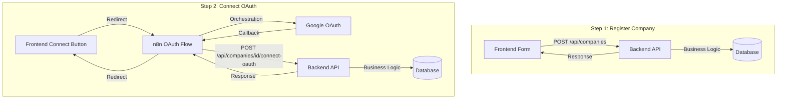

# Two-Step Company Registration Implementation Plan

## Overview

This plan implements a two-step registration process that aligns with the architecture:

- **Step 1**: Register company (name + email) directly via backend - business logic in code
- **Step 2**: Connect OAuth tokens later via n8n workflow - orchestration in n8n

This separates concerns: n8n handles "When? In what order? What to call next?" while code handles "What does this mean? What should we do?"

---

## Architecture Flow



---

## Implementation Tasks

### Backend Changes

#### 1. Update Company Model (`backend/models/company.py`)

- Make `encrypted_access_token` and `encrypted_refresh_token` nullable (Optional)
- Add validation to ensure tokens are present before allowing Gmail/Drive operations
- **Reason**: Companies can exist without OAuth tokens initially

#### 2. Create New Schema (`backend/schemas/company.py`)

- Add `OAuthConnectRequest` schema for Step 2:
  ```python
  class OAuthConnectRequest(BaseModel):
      access_token: str
      refresh_token: str
      n8n_credential_id: Optional[str] = None
      expires_in: Optional[int] = 3600
  ```

- Keep existing `CompanyCreate` schema (name + email only)
- Keep existing `CompanyRegisterRequest` (for backward compatibility with n8n)

#### 3. Add Step 1 Endpoint (`backend/routers/companies.py`)

- Create `POST /api/companies/` endpoint (admin only)
- Accepts `CompanyCreate` (name + email)
- Creates company without tokens (tokens set to NULL)
- Returns `CompanyResponse`
- **Business Logic**: Validation, duplicate check, company creation

#### 4. Add Step 2 Endpoint (`backend/routers/companies.py`)

- Create `POST /api/companies/{company_id}/connect-oauth` endpoint (admin only)
- Accepts `OAuthConnectRequest` (tokens)
- Updates existing company with encrypted tokens
- Validates company exists
- Returns `CompanyResponse`
- **Business Logic**: Token validation, encryption, storage, refresh logic

#### 5. Update Tenant Service (`backend/services/tenant.py`)

- Add `create_company_without_tokens()` method for Step 1
- Add `connect_oauth_to_company()` method for Step 2
- Update `create_company()` to handle optional tokens (backward compatibility)
- **Business Logic**: All validation and encryption logic

#### 6. Update Company Response (`backend/schemas/company.py`)

- Add `has_oauth_connected: bool` field to `CompanyResponse`
- Indicates if company has OAuth tokens connected
- Helps frontend show "Connect OAuth" button

---

### Frontend Changes

#### 7. Update AddCompanyModal (`frontend/src/components/AddCompanyModal.tsx`)

- **Step 1 Mode**: Simple form with Name + Email fields
- Remove OAuth redirect logic from initial submit
- Call `POST /api/companies/` directly
- Show success message and close modal
- **Step 2 Mode**: Add "Connect Gmail & Drive" button (separate action)

#### 8. Update Companies Page (`frontend/src/pages/Companies.tsx`)

- Display OAuth connection status for each company
- Show "Connect Gmail & Drive" button for companies without OAuth
- Button triggers OAuth flow (redirects to n8n)
- Update company cards to show connection status

#### 9. Update API Client (`frontend/src/lib/api.ts`)

- Add `companiesAPI.create()` for Step 1:
  ```typescript
  create: (data: { name: string; email: string }) => 
    api.post('/api/companies/', data)
  ```

- Add `companiesAPI.connectOAuth()` for Step 2:
  ```typescript
  connectOAuth: (companyId: string, data: OAuthData) => 
    api.post(`/api/companies/${companyId}/connect-oauth`, data)
  ```


---

### n8n Workflow Changes

#### 10. Create Simplified OAuth Workflow (`Company OAuth Connection.json`)

- **Purpose**: Connect OAuth to existing company (Step 2 only)
- **Flow**:

  1. Webhook receives OAuth callback (with `company_id` in state)
  2. Extract OAuth code
  3. Exchange code for tokens (orchestration)
  4. Call backend: `POST /api/companies/{company_id}/connect-oauth`
  5. Redirect to frontend success page

- **n8n Responsibility**: Orchestration only (when, in what order, what to call)
- **No Business Logic**: No email extraction, no data preparation - just orchestration

#### 11. Update Frontend OAuth Redirect

- When "Connect Gmail & Drive" clicked, redirect to n8n OAuth URL
- Include `company_id` in state parameter (not company name)
- n8n workflow extracts `company_id` and uses it in backend call

---

## Database Migration

#### 12. Update Company Table Schema

- Make `encrypted_access_token` and `encrypted_refresh_token` nullable
- Update `access_token_expires_at` to nullable
- Create migration script or update `init_db.py`
- **Note**: Existing companies with tokens remain valid

---

## Testing Strategy

#### 13. Test Step 1: Direct Registration

- Test creating company with name + email
- Verify company created without tokens
- Verify duplicate email prevention
- Verify admin authentication required

#### 14. Test Step 2: OAuth Connection

- Test OAuth flow with existing company
- Verify tokens encrypted and stored
- Verify company updated correctly
- Verify error handling for invalid company_id

#### 15. Test Backward Compatibility

- Verify existing `/api/companies/register` endpoint still works (for n8n)
- Verify companies with tokens continue to function
- Verify no breaking changes to existing workflows

---

## File Changes Summary

### Backend Files to Modify

- `backend/models/company.py` - Make token fields nullable
- `backend/schemas/company.py` - Add `OAuthConnectRequest`, update `CompanyResponse`
- `backend/routers/companies.py` - Add Step 1 and Step 2 endpoints
- `backend/services/tenant.py` - Add methods for two-step registration

### Frontend Files to Modify

- `frontend/src/components/AddCompanyModal.tsx` - Split into Step 1 and Step 2
- `frontend/src/pages/Companies.tsx` - Add OAuth connection UI
- `frontend/src/lib/api.ts` - Add new API methods

### n8n Files to Create

- `Company OAuth Connection.json` - New simplified workflow for Step 2

### Documentation Files to Update

- Update `our_plan_now.md` with new two-step flow
- Create migration guide for existing companies

---

## Implementation Order

1. **Backend First**: Database schema, models, schemas, services, routes
2. **Frontend Second**: Update UI for Step 1, then add Step 2 UI
3. **n8n Last**: Create simplified OAuth workflow
4. **Testing**: Test each step independently, then end-to-end

---

## Benefits

- **Clear Separation**: n8n = orchestration, Code = business logic
- **Simpler**: Fewer failure points, easier debugging
- **Flexible**: Register companies anytime, connect OAuth when ready
- **Maintainable**: Business rules in code, not workflows
- **Testable**: Each step can be tested independently

---

## Migration Path

- Existing `/api/companies/register` endpoint remains for backward compatibility
- Existing companies with toke